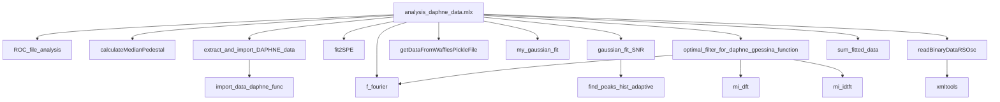

# analysis_daphne_data dependencies

## Alcance

Mapa obtenido mediante revisión estática del Live Script y de los archivos `.m` staged. No demuestra que todas las ramas se ejecuten ni que todas las dependencias dinámicas estén presentes.

## Grafo estático

## Dependencias directas

| Dependencia | Rol cualitativo inicial | Ficha |
|---|---|---|
| `ROC_file_analysis` | Derivación de métricas/curva ROC a partir de conteos de clasificación | [[ROC_file_analysis]] |
| `calculateMedianPedestal` | Estimación robusta de pedestal mediante regiones de pretrigger | [[calculateMedianPedestal]] |
| `extract_and_import_DAPHNE_data` | Extracción e importación de archivos DAPHNE | [[extract_and_import_DAPHNE_data]] |
| `f_fourier` | FFT, espectros unilaterales, PSD y RMS; procedencia del árbol FIUNA | [[f_fourier]] |
| `fit2SPE` | Alineación y escalado de la respuesta de un modelo a un waveform SPE | [[fit2SPE]] |
| `gaussian_fit_SNR` | Estimación de SNR mediante ajuste de picos gaussianos | [[gaussian_fit_SNR]] |
| `getDataFromWafflesPickleFile` | Lectura de datos serializados provenientes de waffles/Python | [[getDataFromWafflesPickleFile]] |
| `my_gaussian_fit` | Ajuste gaussiano auxiliar | [[my_gaussian_fit]] |
| `optimal_filter_for_daphne_gpessina_function` | Construcción/cálculo de filtro óptimo | [[optimal_filter_for_daphne_gpessina_function]] |
| `readBinaryDataRSOsc` | Lectura de datos binarios de osciloscopio Rohde & Schwarz | [[readBinaryDataRSOsc]] |
| `sum_fitted_data` | Suma/evaluación de componentes ajustadas | [[sum_fitted_data]] |

## Dependencias transitivas

| Llamante | Dependencia | Ficha |
|---|---|---|
| `extract_and_import_DAPHNE_data` | `import_data_daphne_func` | [[import_data_daphne_func]] |
| `gaussian_fit_SNR` | `find_peaks_hist_adaptive` | [[find_peaks_hist_adaptive]] |
| `optimal_filter_for_daphne_gpessina_function` | `mi_dft` | [[mi_dft]] |
| `optimal_filter_for_daphne_gpessina_function` | `mi_idtft` | [[mi_idtft]] |
| `optimal_filter_for_daphne_gpessina_function` | `f_fourier` | [[f_fourier]] |
| `readBinaryDataRSOsc` | `xmltools` | [[xmltools]] |

## Dependencias no staged o externas

- Funciones built-in y toolboxes de MATLAB no se copian al repositorio.
- Los datos `.mat`, `.npy`, `.7z`, pickle y binarios de osciloscopio permanecen fuera de esta etapa.
- Las llamadas dinámicas, ramas de configuración y funciones locales pueden no estar representadas por el escaneo léxico.
- `ParforProgMon` figura en el MATLABPATH histórico, pero no quedó resuelto como dependencia activa de esta copia; en el Live Script aparecen referencias comentadas a `ParforProgressbar`.

## Evidencia y certeza

- **Observado:** las aristas del grafo aparecen en `inventory/analysis_daphne_data_static_dependencies.json`.
- **Inferido:** el rol cualitativo se deduce de nombres, firmas y código revisado estáticamente.
- **Desconocido:** la rama utilizada en cada campaña de adquisición y la cobertura efectiva durante runtime.

## Enlaces

- [[analysis_daphne_data]]
- [[MATLAB_SCRIPT_CATALOG]]
- [[DOCUMENTATION_GUIDE]]
